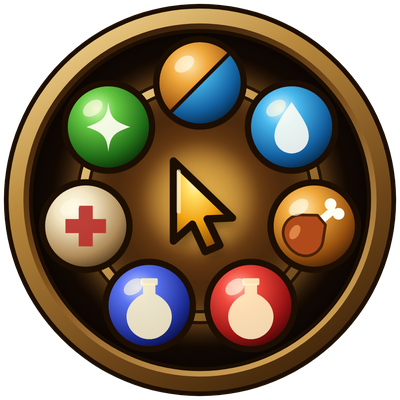

# Radial Consumables

**Your food, drink and potions in a ring at the mouse.**

A WoW: Forever addon. Press a key, click what you need.

## Features

- **Opens at the mouse**: Alt+F by default. Kept clear of the screen edges.
- **Fills itself**: reads your bags. Nothing to drag, nothing to set up.
- **Eat and drink at once**: twelve o'clock eats your best food and drinks your best drink in one click.
- **Sorted by kind**: clockwise from the top, eat & drink, drinks, food, health, mana, first aid, everything else.
- **Best first**: each slice uses its best item. Hover it and the rest fan out around it, best to worst clockwise.
- **Buff food marked**: a green arrow on food and drink that also gives you a buff.
- **Quick to cancel**: release anywhere else to close. Right-click goes back a level, Escape closes.
- **Works in combat**: open it and drink a potion mid-fight.
- **Every client language**: items are told apart by the game's own data, not their names.

## Setup

Nothing to set up. Change the key in Key Bindings > Radial Consumables.

Install from the GitHub releases, or copy this repo into `Interface/AddOns/RadialConsumables`.

## Download

[GitHub releases](https://github.com/f4nu/radial-consumables/releases)

## Bugs and ideas

[GitHub issues](https://github.com/f4nu/radial-consumables/issues)
